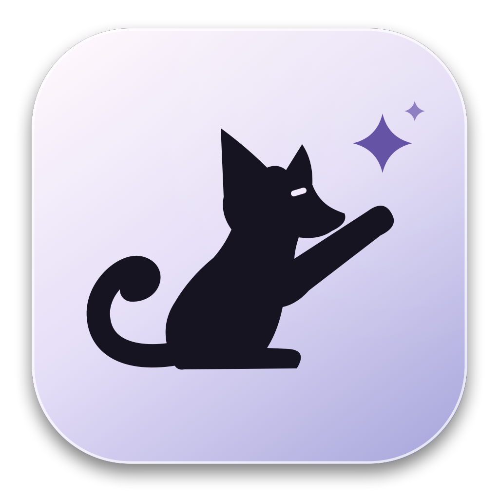
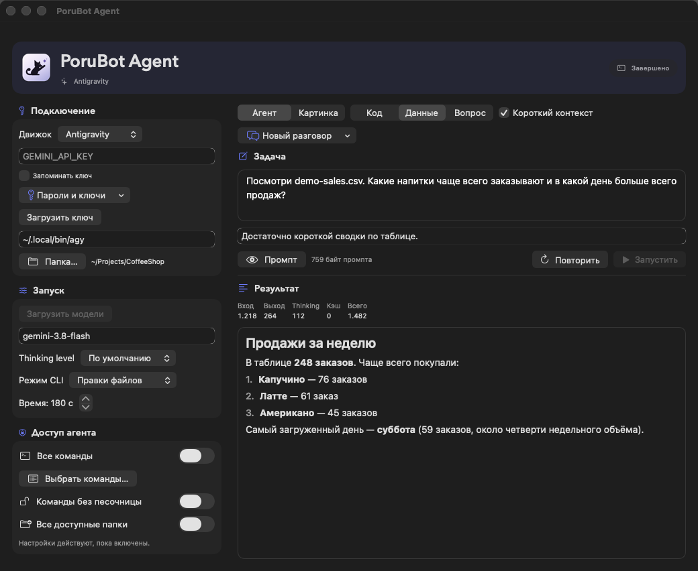
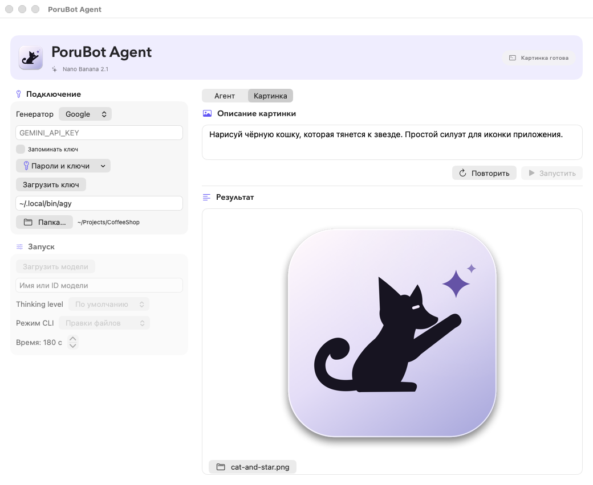

<p align="center"></p>

<h1 align="center">PoruBot Agent</h1>

<p align="center"><a href="README.md">Русский</a> · <strong>English</strong></p>

<p align="center">Run agents for code, spreadsheets, and files from one window.<br>Choose a folder, describe the task, and run an agent with your own API key.</p>

<p align="center"><a href="https://github.com/porubovsky/PoruBot-Agent/releases/latest"><strong>Download for macOS or Windows</strong></a></p>



## Getting started

1. Download a build from the release page. On **macOS 13+ (Intel)**, open the DMG and drag PoruBot Agent to Applications. On **Windows 10/11 x64**, extract the ZIP and open `PoruBot Agent.exe`.
2. Choose an engine, enter your API key, and select a working folder. If the CLI is missing, PoruBot downloads and runs the provider's official installer.
3. Describe a task, such as “Look at the sales spreadsheet and find the busiest day.” Choose a model and thinking level or use the defaults.

| Engine | API key |
| --- | --- |
| Antigravity | Gemini API key from Google AI Studio |
| Codex | OpenAI API key |
| Claude Code | Anthropic API key |
| OpenRouter | OpenRouter API key. Runs through Claude Code. |

On macOS, **Remember key** saves your key in Keychain. On Windows, **Save key** uses encrypted storage tied to your Windows profile. The Windows toolbar offers light, dark, and system themes.

Choose **Русский** or **English** in the toolbar. The language changes the next time you launch PoruBot.

## What you can do

- **Work on a project.** Pick the Code, Data, or Question profile. Use **Plan** to ask for an outline before changes begin. **Short context** asks the agent to stay within scope, and **Prompt** shows what PoruBot will send.
- **Resume a conversation.** For Codex and Antigravity, select a previous conversation for the working folder. You can also enter a session ID from the CLI.
- **Follow a run.** The status line shows what the CLI is doing and how much time has elapsed. **Stop** keeps the output received so far. **Repeat** sends the last request again with the same settings. Changes already made to files remain after you stop a run.
- **Track usage.** PoruBot shows token counts when the CLI reports them. It displays Claude Code's cost estimate and can estimate OpenRouter costs from current catalog rates when exact model IDs and token counts are available.

## Generate images

Switch to **Image**, choose Google (Nano Banana 2.1) or OpenAI (GPT Image 2.6 Flare), and describe the image you want. PoruBot uses the selected provider's API key and saves the result to the working folder.

To guide either generator with an image, select **Add reference…**, choose a PNG, JPEG, or WebP file up to 10 MB, and describe what to keep or change. PoruBot sends the reference with your prompt when you run the request. The result is saved as a separate file.



*The screenshots show demo content in the Russian interface.*

<details>
<summary>Agent access</summary>

Start with the project's working folder. Extended access settings persist between launches. Plan mode leaves extended access disabled. Antigravity has separate controls for allowing all commands, accessing other folders, and running commands outside the sandbox within your operating system permissions.

On Windows, Claude Code and OpenRouter can work with files. Choose Antigravity or Codex for tasks that require running shell commands.

</details>

<details>
<summary>Build from source</summary>

On macOS, install the Xcode Command Line Tools and run `bash macOS/build.sh`. The script builds for the current Mac's architecture.

For Windows, use the .NET 10 SDK.

```sh
dotnet publish Windows/Desktop/PoruBot.csproj -c Release -r win-x64 --self-contained true -p:PublishSingleFile=true -p:IncludeNativeLibrariesForSelfExtract=true
```

The icon source and packaging script are in `Artwork`.

</details>
