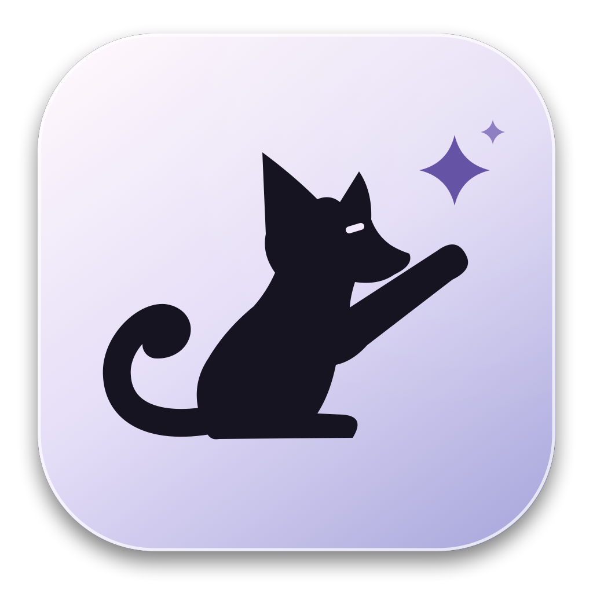
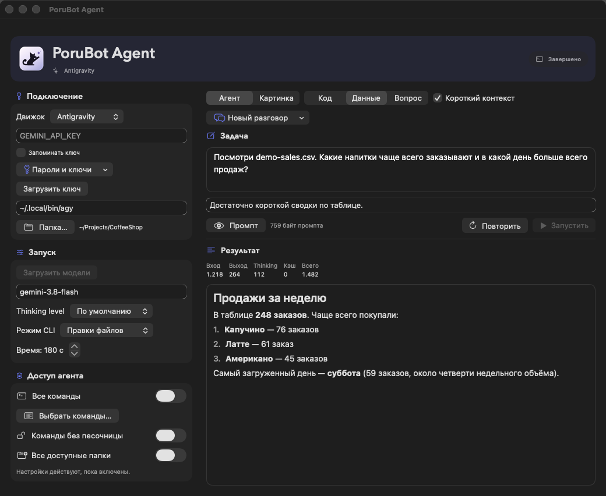
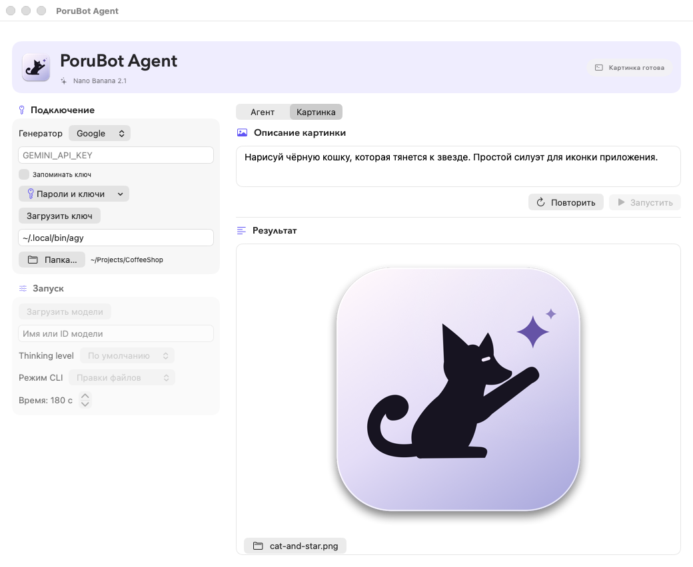

<p align="center"></p>

<h1 align="center">PoruBot Agent</h1>

<p align="center">Агенты для кода, таблиц и файлов в одном окне.<br>Выберите папку, напишите задачу и запустите агента со своим API-ключом.</p>

<p align="center"><a href="https://github.com/porubovsky/PoruBot-Agent/releases/latest"><strong>Скачать для macOS или Windows</strong></a></p>



## С чего начать

1. Скачайте сборку на странице релиза. На **macOS 13+ (Intel)** откройте DMG и перетащите PoruBot Agent в «Программы». На **Windows 10/11 x64** распакуйте ZIP и откройте `PoruBot Agent.exe`.
2. Выберите движок, вставьте API-ключ и укажите рабочую папку. Если нужного CLI ещё нет, PoruBot скачает и запустит официальный установщик.
3. Напишите задачу, например «Посмотри таблицу продаж и найди самый загруженный день». Выберите модель и Thinking level или оставьте настройки по умолчанию.

| Движок | Какой ключ нужен |
| --- | --- |
| Antigravity | Gemini API-ключ из Google AI Studio |
| Codex | OpenAI API-ключ |
| Claude Code | Anthropic API-ключ |
| OpenRouter | OpenRouter API-ключ. Запуск через Claude Code |

Опция «Запоминать ключ» сохраняет его в Связке ключей macOS. На Windows кнопка «Сохранить ключ» использует зашифрованное хранилище вашего профиля. В верхней строке Windows можно выбрать светлую, тёмную или системную тему.

Язык интерфейса можно выбрать в верхней строке окна: «Русский» или «English». Изменение вступит в силу при следующем запуске.

## Что можно делать

- **Работать с проектом.** Используйте профили «Код», «Данные» и «Вопрос». В режиме «План» можно сначала попросить агента описать ход работы. «Короткий контекст» добавляет в промпт просьбу ограничиться задачей, а кнопка «Промпт» показывает, что будет отправлено.
- **Продолжать разговор.** В Codex и Antigravity прошлые разговоры доступны в списке для выбранной папки. Если разговор начали в CLI, его можно открыть по ID сессии.
- **Следить за запуском.** Вверху видно, чем занят CLI и сколько времени прошло. «Остановить» оставляет уже полученный текст, «Повторить» заново отправляет последний запрос с прежними настройками. Уже внесённые правки остаются после остановки.
- **Смотреть расход.** PoruBot показывает токены, когда CLI их сообщает. Для Claude Code отображается оценка CLI, а для OpenRouter — оценка по актуальному каталогу при наличии точных моделей и разбивки токенов.

## Генерация картинок

Переключитесь на «Картинка», выберите Google (Nano Banana 2.1) или OpenAI (GPT Image 2.6 Flare) и опишите, что хотите получить. Изображение появится в окне и сохранится в выбранной папке. Для генерации нужен ключ выбранного провайдера.

В Nano Banana и GPT Image нажмите «Добавить образец…», выберите PNG, JPEG или WebP до 10 МБ и опишите, что изменить или взять за основу. Образец отправляется выбранному провайдеру вместе с промптом при запуске. Исходный файл остаётся на месте, а результат сохраняется отдельно.



*На скриншотах демонстрационная задача и пример изображения.*

<details>
<summary>Доступ агента</summary>

Начните с рабочей папки проекта. Переключатели расширенного доступа сохраняются между запусками. В режиме «План» они не применяются. В Antigravity можно отдельно разрешить все команды, доступ к другим папкам и запуск команд без песочницы в рамках разрешений ОС.

На Windows Claude Code и OpenRouter могут работать с файлами, а для задач с командами можно выбрать Antigravity или Codex.

</details>

<details>
<summary>Сборка из исходников</summary>

На macOS установите Xcode Command Line Tools и запустите `bash macOS/build.sh`. Скрипт соберёт приложение для архитектуры текущего Mac.

Для Windows используйте .NET 10 SDK.

```sh
dotnet publish Windows/Desktop/PoruBot.csproj -c Release -r win-x64 --self-contained true -p:PublishSingleFile=true -p:IncludeNativeLibrariesForSelfExtract=true
```

Исходник иконки и скрипт упаковки находятся в `Artwork`.

</details>
